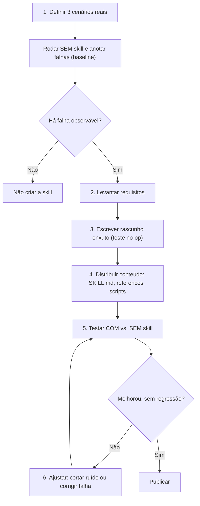
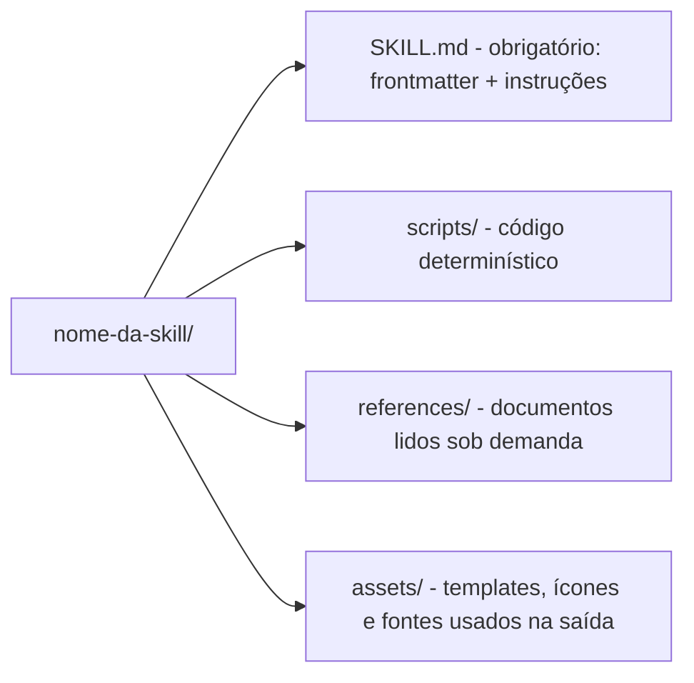
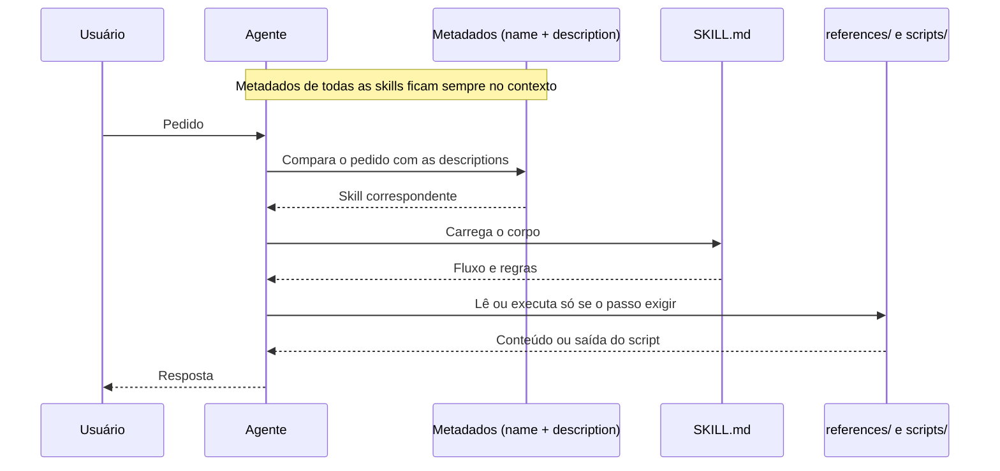

# Guia de criação de skills

Processo essencial para definir, escrever, enxugar e validar uma skill (`SKILL.md`).

## 1. Visão geral

Uma skill é uma pasta com um `SKILL.md` (frontmatter + instruções) e, opcionalmente, scripts, referências e assets. O objetivo não é fazer a IA "saber mais", e sim fazê-la **seguir o mesmo processo em toda execução** nos pontos em que ela erra ou varia sem instrução específica.

> **Regra de ouro:** só crie uma skill se existir um comportamento observável que melhora *com* ela em comparação *sem* ela. Se o modelo já acerta sozinho, a skill é custo sem benefício.

## 2. Fluxo de criação



| # | Etapa | O que fazer |
|---|-------|-------------|
| 1 | Cenários e baseline | Escolha 3 tarefas reais e rode sem skill. Anote onde o modelo erra, varia ou esquece algo. |
| 2 | Requisitos | Defina tarefa/domínio, casos de uso, o que precisa ser determinístico (script) e o material de apoio. |
| 3 | Rascunho enxuto | Aplique o teste no-op (seção 6) a cada linha. Escreva só o que corrige uma falha do baseline. |
| 4 | Distribuição | Fluxo e regras no `SKILL.md`; material volumoso em `references/`; operações frágeis em `scripts/`. |
| 5 | Teste com vs. sem | Mesmos cenários, sessões isoladas, mesmo modelo. Compare comportamento observável (passos seguidos, omissões, conteúdo inventado). |
| 6 | Iteração | Remova o que não mudou o resultado, adicione só o que corrigiu uma falha e reteste. |

## 3. Anatomia de uma skill



| Item | Regra (documentação Anthropic) |
|------|-------------------------------|
| `name` | Até 64 caracteres; minúsculas, números e hífens. |
| `description` | Até 1.024 caracteres; terceira pessoa; diz o que faz e quando usar. |
| Corpo do `SKILL.md` | Menos de 500 linhas; acima disso, dividir em arquivos. |
| Referências | Um nível de profundidade a partir do `SKILL.md`; arquivos com mais de 100 linhas ganham sumário no topo. |

Esqueleto mínimo:

```markdown
---
name: processando-pdfs
description: Extrai texto e tabelas de PDFs e preenche formulários. Use quando o usuário mencionar PDFs, formulários ou extração de documentos.
---

# Processando PDFs

## Fluxo
1. Verifique se o PDF tem texto selecionável; se não, rode scripts/ocr.py.
2. Extraia com pdfplumber.
3. Valide com scripts/validar.py antes de responder.

## Avançado
- Formulários: ver references/formularios.md (ler só se o pedido envolver formulário)
```

## 4. Descrição: o campo mais importante

É a única parte que o agente enxerga ao decidir se carrega a skill. Todos os gatilhos ("use quando...") ficam **aqui**; uma seção "Quando usar" no corpo só seria lida depois que a skill já foi escolhida.

| | Exemplo |
|---|---------|
| ✅ Bom | Extrai texto e tabelas de PDFs, preenche formulários e une documentos. Use ao trabalhar com PDFs ou quando o usuário mencionar formulários ou extração de documentos. |
| ❌ Ruim | Ajuda com documentos. |

- Escreva em terceira pessoa, com o que a skill faz *e* quando usar.
- Um gatilho por situação: sinônimos do mesmo gatilho só aumentam o custo.
- Seja específico o bastante para não acionar a skill em tarefas vizinhas.

## 5. Contexto e divulgação progressiva



- **Metadados:** sempre no contexto, de todas as skills instaladas.
- **`SKILL.md`:** carregado só quando a skill é acionada; depois permanece no contexto da conversa.
- **Recursos:** lidos ou executados só quando o passo exige. Scripts consomem tokens apenas pela saída, não pelo código.

**Consequência prática:** a descrição custa em todo turno, então merece a poda mais dura. O que só serve em um ramo do fluxo vai para `references/`, com um ponteiro dizendo *quando* ler.

## 6. Poda: o que cortar e o que manter

Teste **no-op**: se remover uma instrução não muda o comportamento do agente, ela é ruído. Divergências sobre uma linha se resolvem *rodando* a skill, não discutindo.

| Cortar ou mover para `references/` | Manter no `SKILL.md` |
|-----------------------------------|----------------------|
| Conselhos genéricos ("seja profissional", "escreva código limpo") | Regras específicas e não óbvias do seu contexto |
| Teoria e explicações longas | Passos ordenados e critérios de conclusão |
| A mesma regra repetida com outras palavras | Restrições de segurança e casos de borda que quebram o fluxo |
| Introduções e conclusões | Um ou dois exemplos curtos de entrada e saída |
| Conteúdo útil em apenas um ramo do fluxo | Ponteiros que dizem quando ler cada referência |

> **Limites do no-op:** o que é no-op depende do modelo. Uma linha inútil em um modelo forte pode ser essencial em um menor, então reteste ao trocar de modelo. Poda agressiva demais também apaga regras raras; inclua casos de borda nos testes.

**Exemplos:** um exemplo bom costuma ensinar mais que dez regras abstratas, mas o modelo tende a copiar o formato dele. Use poucos, curtos e variados; exemplos longos vão para `references/`.

## 7. Ferramentas de apoio

| Ferramenta | Papel no processo |
|------------|-------------------|
| `skill-creator` | Cria estrutura e frontmatter válidos, modifica skills existentes e ajuda a medir desempenho. O primeiro rascunho costuma vir longo e precisa de poda. |
| `write-a-skill` | Processo guiado: levanta requisitos, redige o rascunho e revisa com você. |
| `writing-for-agents` | Referência de escrita para documentos lidos por agentes (antes chamada `writing-great-skills`). Corrige excesso apagando, não explicando mais. |

> **Copilot:** `name` e `description` em minúsculas, nome sem a palavra "skill", frontmatter apenas com esses dois campos, arquivo `agents/ui_metadata.yaml` e pacote `skill.zip` de até 25 MB.

## 8. Checklist antes de publicar

- [ ] Existe um baseline sem skill mostrando a falha que ela corrige.
- [ ] Descrição em terceira pessoa, com o que faz e quando usar, sem sinônimos repetidos.
- [ ] `SKILL.md` com menos de 500 linhas e cada linha passa no teste no-op.
- [ ] Referências a um nível de profundidade, com sumário se passarem de 100 linhas e ponteiros de "quando ler".
- [ ] Operações frágeis ou repetitivas viraram scripts testados.
- [ ] Terminologia consistente e caminhos com barra normal (`/`).
- [ ] Teste com vs. sem skill nos mesmos cenários, incluindo casos de borda.
- [ ] Nome, descrição e pacote respeitam as regras da plataforma de destino.

## Referências

- [Skill authoring best practices (Anthropic)](https://platform.claude.com/docs/en/agents-and-tools/agent-skills/best-practices)
- [/writing-for-agents (AI Hero)](https://www.aihero.dev/skills-writing-for-agents)
- [mattpocock/skills](https://github.com/mattpocock/skills)
