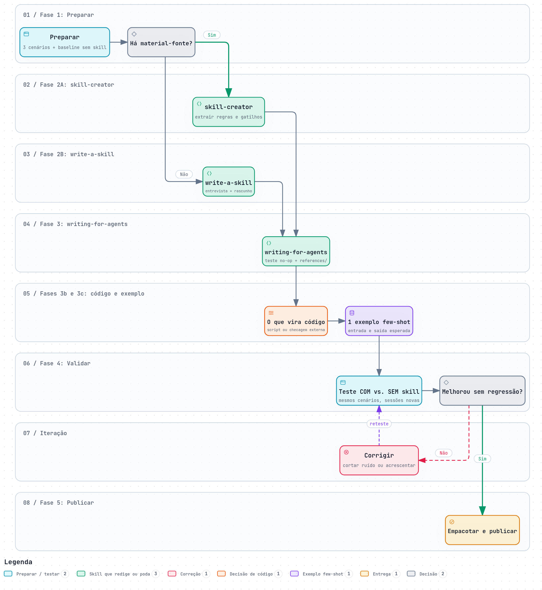

# Processo prático de criação de skills

Pipeline em 5 fases usando três ferramentas, cada uma no papel em que é mais forte:

| Ferramenta | Papel no processo | Quando entra |
|------------|-------------------|--------------|
| `skill-creator` (Anthropic) | **Estruturar:** gera `SKILL.md` com frontmatter válido, gatilhos e casos de teste; também modifica skills existentes e mede desempenho | Fases 2 e 4 |
| `write-a-skill` (Matt Pocock) | **Entrevistar:** levanta requisitos com você, redige o rascunho e revisa em conjunto | Fase 2, quando não há material-fonte |
| `writing-for-agents` (Matt Pocock; antes `writing-great-skills`) | **Lapidar:** aplica o teste *no-op* e corta tudo que o modelo já faz sozinho | Fase 3 |

> **Ideia central:** o gerador estruturado produz um rascunho **completo, porém inchado**; o filtro de poda o transforma em algo **enxuto e previsível**; o teste com vs. sem skill prova que valeu a pena.

## Visão do processo



## Fase 1: Preparar (antes de qualquer skill)

1. **Escolha 3 cenários reais** em que a IA erra, varia ou esquece algo. Inclua 1 caso de borda.
2. **Rode cada cenário sem skill**, em sessão nova, e guarde as saídas. É o seu baseline.
3. **Reúna o material-fonte**, se existir (Markdown de documentação, histórico de uma tarefa bem-sucedida, regras internas).
4. **Decida:** se o baseline já sai bom, pare aqui; a skill não se justifica.

**Entregável:** pasta com `cenarios.md` (3 pedidos) e `baseline/` (saídas sem skill).

## Fase 2: Estruturar

### 2A. Com material-fonte → `skill-creator`

Prompt sugerido:

```text
Use a skill skill-creator. Material-fonte em anexo.
Extraia apenas: (1) regras de decisão que a IA não aplica bem sozinha,
(2) o fluxo passo a passo, (3) frases de gatilho para a description.
Ignore explicações, histórias e contexto. Coloque o que for volumoso em references/.
Marque separadamente o que é operação determinística (candidata a script).
Gere o SKILL.md com frontmatter e proponha 3 casos de teste.
```

### 2B. Sem material-fonte → `write-a-skill`

Prompt sugerido:

```text
Use a skill write-a-skill. Quero uma skill para [tarefa].
Faça perguntas até ter: tarefa/domínio, casos de uso, o que precisa de script
e que material de referência existe. Depois redija o rascunho e revise comigo.
```

**Entregável:** rascunho de `SKILL.md` (esperado: longo e redundante; é normal) + pasta `references/` se houver.

## Fase 3: Lapidar com `writing-for-agents`

Prompt sugerido:

```text
Use a skill writing-for-agents. Revise o SKILL.md em anexo.
Aplique o teste no-op linha por linha: se remover a linha não muda o
comportamento do agente, apague. Corte conselhos genéricos, introduções,
conclusões e regras repetidas com outras palavras.
Mova conteúdo útil só em um ramo do fluxo para references/, deixando no
SKILL.md um ponteiro dizendo quando ler. Liste o que removeu e por quê.
```

Regras que a revisão deve garantir:

| Item | Critério |
|------|----------|
| `description` | Terceira pessoa; diz o que faz **e** quando usar; todos os gatilhos ficam aqui |
| Corpo | Menos de 500 linhas; só fluxo, regras não óbvias e casos de borda |
| `references/` | Um nível de profundidade; sumário se passar de 100 linhas |
| `scripts/` | Para o que precisa ser determinístico (ver Fase 3b); só a saída consome contexto |

## Fase 3b: Decidir o que vira código

A skill é probabilística: o agente interpreta o texto e pode variar. Tudo o que precisa dar **o mesmo resultado sempre** não deve depender de interpretação. Para cada passo do rascunho, aplique a pergunta:

> *Se eu rodasse este passo 5 vezes, o resultado precisa ser idêntico?* Se sim, é candidato a código.

### Quem fica com a responsabilidade

| Situação | Responsável | Exemplo |
|----------|-------------|---------|
| Várias abordagens válidas; a decisão depende de contexto ou julgamento | **Texto na skill** | Revisar um texto, priorizar itens, escolher o tom |
| Operação determinística, ou o agente geraria o mesmo código toda vez | **Skill + script em `scripts/`** | Validar um arquivo, converter formato, calcular, gerar o artefato final |
| Operação frágil, em que um passo fora de ordem quebra o resultado | **Skill + script em `scripts/`** (execução exata, sem improviso) | Migração, empacotamento, sequência de comandos |
| Erro precisa de tratamento explícito e mensagem previsível | **Skill + script em `scripts/`** | Validador que lista o que falhou e onde |
| Regra **mecânica** (padrão fixo, API proibida, formato de arquivo) que deve valer **mesmo se a skill não for acionada** | **Ferramenta fora da skill**: linter, hook de pré-commit ou CI | Proibir um import, exigir nome de arquivo, rodar typecheck |

### Regras de decisão

- **Texto vs. script:** o script economiza tokens e aumenta a confiabilidade em relação a código gerado na hora. Adicione quando a operação é determinística, o mesmo código seria regenerado a cada uso, ou o erro precisa de tratamento explícito.
- **Skill vs. checagem fora dela:** a skill só atua quando é acionada. Uma regra mecânica deve virar checagem determinística (regra de linter, hook ou job de CI) em vez de uma linha de texto na skill ou no `AGENTS.md`. Reserve o texto para julgamento.
- **Sinal vindo da Fase 1:** se o baseline mostra variação entre execuções em um passo que deveria ser fixo, esse passo é script.
- **Custo de contexto:** o script roda sem carregar o conteúdo no contexto; só a saída consome tokens. Por isso um script grande custa menos que as mesmas instruções em texto.

### Como a skill e o script trabalham juntos

A skill **orquestra** (quando rodar, com quais entradas, o que fazer com o resultado) e o script **executa**. No `SKILL.md`, para cada script:

```markdown
## Validação
Ao terminar o rascunho, execute `scripts/validar.py <arquivo>` (não leia o código do script).
- Saída `OK`: siga para a entrega.
- Saída com erros: corrija os itens listados e execute de novo, até passar.
```

Boas práticas para o script:
- Mensagens de erro explícitas (o que falhou, onde e como corrigir), para o agente conseguir se autocorrigir.
- Um script por responsabilidade, com entrada e saída previsíveis.
- Deixe claro no `SKILL.md` se o agente deve **executar** o script ou **ler** como referência; por padrão, execute.
- Teste o script isoladamente antes de colocá-lo na skill e inclua-o nos cenários da Fase 4.

**Entregável:** lista dos passos classificados (texto, script, checagem externa) e os arquivos em `scripts/`.

## Fase 3c: Um exemplo few-shot

Escolha o melhor caso real do material e escreva uma seção curta `## Exemplo` com **entrada** e **saída esperada**. Um exemplo bom ensina mais que dez regras abstratas, mas o modelo tende a copiar o formato: use poucos, curtos e, se possível, variados.

## Fase 4: Validar com vs. sem skill

1. Instale a skill e rode os **mesmos 3 cenários** da Fase 1, em sessões novas e com o mesmo modelo.
2. Compare com o baseline em **comportamento observável**: seguiu os passos? omitiu algo? inventou conteúdo? acionou a skill no momento certo?
3. Opcional: peça ao `skill-creator` para medir o desempenho dos casos de teste.

| Resultado | Ação |
|-----------|------|
| Skill não foi acionada | Reescrever a `description` (gatilhos) |
| Acionada, mas passos ignorados | Tornar o passo mais explícito; se for um passo que deve ser exato, mover para script (Fase 3b) |
| Resultado varia entre execuções em um passo que devia ser fixo | Transformar o passo em script |
| Script falha ou o agente não o executa | Corrigir a mensagem de erro e o trecho do `SKILL.md` que manda executá-lo |
| Saída igual ao baseline | A linha é no-op: apague; se nada melhora, descarte a skill |
| Regressão em caso de borda | Restaurar a regra cortada na Fase 3 |

Itere: **cortar o que não mudou o resultado, acrescentar só o que corrigiu uma falha observada**, e reteste. Reteste também ao trocar de modelo, porque o que é no-op depende dele.

## Fase 5: Empacotar e publicar

Estrutura do repositório:

```text
nome-da-skill/
├── SKILL.md
├── references/
├── scripts/            # código determinístico chamado pela skill
└── testes/
    ├── cenarios.md
    └── resultados.md   # com vs. sem skill, por modelo e data
```

- Registre em `resultados.md` o baseline, o resultado com skill e o modelo usado.
- Para o **Copilot**: `name` e `description` em minúsculas, nome sem a palavra "skill", frontmatter apenas com esses dois campos, arquivo `agents/ui_metadata.yaml` e pacote `skill.zip` de até 25 MB.
- Para o **Claude**: `name` até 64 caracteres (minúsculas, números e hífens) e `description` até 1.024 caracteres.

## Checklist rápido

- [ ] Baseline sem skill mostra a falha que ela corrige
- [ ] Rascunho gerado por `skill-creator` ou `write-a-skill`
- [ ] Poda feita com `writing-for-agents`, com lista do que foi removido
- [ ] Gatilhos todos na `description`
- [ ] Cada passo classificado: texto, script ou checagem fora da skill
- [ ] Scripts testados isoladamente, com erros explícitos e chamados no `SKILL.md` (executar ou ler)
- [ ] Regras mecânicas viraram linter, hook ou CI, não texto
- [ ] 1 exemplo few-shot curto
- [ ] Teste com vs. sem skill registrado, incluindo caso de borda
- [ ] Empacotado conforme a plataforma de destino

## Referências

- [Skill authoring best practices (Anthropic)](https://platform.claude.com/docs/en/agents-and-tools/agent-skills/best-practices)
- [/writing-for-agents (AI Hero)](https://www.aihero.dev/skills-writing-for-agents)
- [mattpocock/skills](https://github.com/mattpocock/skills)
